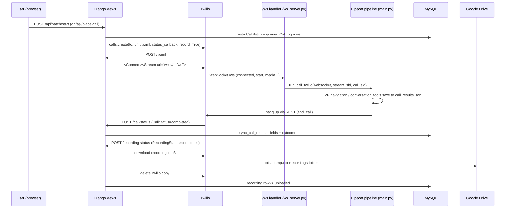
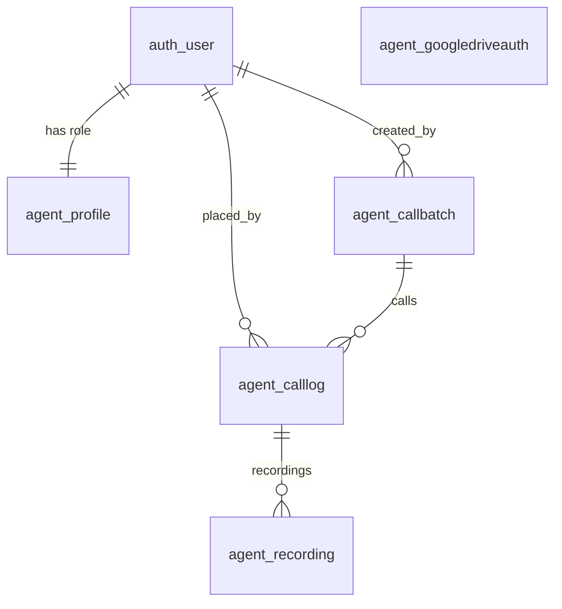

# AI Voice Agent — Complete Project Guide

This document explains the whole project from start to end: what it does,
how a call travels through the system, every module, function, view, model
and database table, how the WebSockets work, and which AI models are used
for speech-to-text, the language model and text-to-speech.

For a shorter "picking the project back up" summary, see `HANDOFF.md`.

---

## Contents

1. [What the project does](#1-what-the-project-does)
2. [Technology and AI models](#2-technology-and-ai-models)
3. [Repository layout](#3-repository-layout)
4. [A call from start to end](#4-a-call-from-start-to-end)
5. [Running the project](#5-running-the-project)
6. [Process architecture: ASGI, uvicorn and the dispatcher](#6-process-architecture-asgi-uvicorn-and-the-dispatcher)
7. [WebSockets and Twilio Media Streams in detail](#7-websockets-and-twilio-media-streams-in-detail)
8. [The voice pipeline (`main.py`)](#8-the-voice-pipeline-mainpy)
9. [The conversation: prompt, IVR goal and tools](#9-the-conversation-prompt-ivr-goal-and-tools)
10. [`main.py` function reference](#10-mainpy-function-reference)
11. [The Django app](#11-the-django-app)
12. [Views and URL reference](#12-views-and-url-reference)
13. [Database and models](#13-database-and-models)
14. [Services: batches, recordings, exports](#14-services-batches-recordings-exports)
15. [In-memory state (`agent/state.py`)](#15-in-memory-state-agentstatepy)
16. [Call outcomes](#16-call-outcomes)
17. [Google Drive OAuth](#17-google-drive-oauth)
18. [Front end](#18-front-end)
19. [Logins and roles](#19-logins-and-roles)
20. [Logging](#20-logging)
21. [Configuration and environment variables](#21-configuration-and-environment-variables)
22. [Known limits and gotchas](#22-known-limits-and-gotchas)
23. [Project history](#23-project-history)

---

## 1. What the project does

A medical lien management company has to verify every claim with the
insurance company: is the claim on file, what is its status, and who is the
adjuster (name, phone, email, fax). Staff normally do this by phone.

This project is an AI agent, called **Emily**, that makes those calls:

1. A user uploads an Excel sheet of claims (one row per claim).
2. The app places a real phone call through **Twilio** for each row.
3. If an automated phone menu (IVR) answers, the agent navigates it, or dials
   the known extension.
4. When a person answers, Emily introduces herself, gives the claim number,
   date of injury and patient name, and collects the claim status and the
   adjuster's contact details, confirming each answer back.
5. Everything collected is saved per call in a **MySQL** database; every call
   is recorded and the recording is moved to **Google Drive**.
6. Admins review calls, play recordings and download results as Excel.

## 2. Technology and AI models

### AI models

| Role | Service | Model / setting | Where configured |
|---|---|---|---|
| Speech-to-text (STT) | **Deepgram** (streaming) | Pipecat's default for `DeepgramSTTService`: **`nova-3-general`**, English | `_build_pipeline()` in `main.py` |
| Language model (LLM) | **OpenAI** | **`gpt-6-luna`**, temperature 0.3, max 120 output tokens, `reasoning_effort: none` | `_build_pipeline()` |
| Text-to-speech (TTS) | **Cartesia** | **`sonic-3.6`**, voice from `CARTESIA_VOICE_ID` | `_build_pipeline()` |
| Voice activity detection (VAD) | **Silero VAD** (runs locally on CPU via onnxruntime) | `SileroVADAnalyzer()` defaults | `_build_pipeline()` |
| Person-vs-menu check and menu navigation | **OpenRouter** | `qwen/qwen3.8-27b` (`MENU_LLM_MODEL`), no reasoning; switched to gpt-6-luna (`LLMSwitcher`) once a person answers. Off without `OPENROUTER_API_KEY` | `_make_services()` |
| Turn detection | **Pipecat smart turn v3** (local ONNX) | decides from the voice when the rep has finished; `TURN_DETECTION=timeout` restores the fixed 1.0 s | `_make_services()` |
| Call-history summarizer | **OpenAI** | `gpt-6-luna`, max 150 tokens | `ContextTrimmer` in `main.py` |
| IVR navigation | Same OpenAI LLM, driven by Pipecat's `IVRNavigator` | — | `_build_pipeline()` |

Notes:
- Cartesia was moved from `sonic-2` to `sonic-3.6` because Cartesia retired
  `sonic-2` on 2026-10-20.
- `gpt-6-luna` only accepts the default temperature for plain completions,
  which is why the summarizer call passes no temperature.
- `groq` is still in `requirements.txt` from an earlier version; nothing uses
  it now.

### Frameworks and services

| Piece | What it is | Version (requirements.txt) |
|---|---|---|
| Pipecat | Real-time voice AI pipeline framework | `pipecat-ai==1.8.0` |
| Django | Web framework (views, auth, ORM, admin) | `Django==5.2.18` (5.2 LTS) |
| uvicorn | ASGI server that runs the app | `uvicorn==0.52.4` |
| Starlette | Provides the `WebSocket` class Pipecat's transport needs | `starlette==1.6.0` |
| Twilio | Telephony: outbound calls, Media Streams, recordings | `twilio==9.11.1` |
| MySQL + mysqlclient | Database and its Python driver | `mysqlclient==2.3.0` |
| Google API client + OAuth | Google Drive upload/download | `google-api-python-client==2.201.0`, `google-auth-oauthlib==1.5.0` |
| openpyxl | Reading the claims sheet, writing the Excel export | `openpyxl==3.1.5` |
| loguru | Logging | `loguru==0.7.3` |
| python-dotenv | Loads `.env` | `python-dotenv==1.2.3` |
| ngrok | Public HTTPS URL for Twilio webhooks and Google OAuth | (separate tool) |

Python 3.12 in a virtualenv (`venv/`).

## 3. Repository layout

```
AI-Voice-Agent/
├── main.py                  The voice pipeline and all call logic (framework-agnostic)
├── run.py                   Starts uvicorn on the ASGI app (use this, not manage.py runserver)
├── manage.py                Django's command-line tool (migrate, createsuperuser, shell...)
├── requirements.txt
├── .env / .env.example      Secrets and settings (.env is never committed)
├── HANDOFF.md               Short continuity notes
├── PROJECT_GUIDE.md         This file
├── call_results.json        (runtime, git-ignored) the current call's captured fields
├── logs/agent.log           (runtime, git-ignored) log file
├── voiceagent/              Django project configuration
│   ├── settings.py          Apps, middleware, MySQL, auth URLs, log file
│   ├── urls.py              /admin/ + include(agent.urls)
│   ├── asgi.py              Dispatcher: /ws -> Twilio handler, everything else -> Django
│   └── wsgi.py              Unused (generated by Django)
└── agent/                   The Django app
    ├── models.py            Profile, CallBatch, CallLog, Recording, GoogleDriveAuth
    ├── views.py             Every HTTP endpoint
    ├── urls.py              URL routes
    ├── ws_server.py         The /ws Twilio Media Stream handler
    ├── state.py             In-memory, process-local state
    ├── decorators.py        role_required()
    ├── admin.py             Django admin registrations
    ├── services/
    │   ├── batches.py       Placing calls, syncing results, the batch dialer
    │   ├── recordings.py    Twilio -> Google Drive recording pipeline
    │   └── exports.py       Call results -> .xlsx
    ├── templatetags/agent_extras.py   mmss and humanize_key template filters
    ├── templates/agent/     base.html, login.html, index.html (dialer), call_logs.html
    └── migrations/          0001–0004
```

**Design rule:** `main.py` knows nothing about Django. It reads and writes a
local JSON file (`call_results.json`); Django reads that file and copies it
into the database. This kept the pipeline unchanged through the FastAPI →
Django migration.

## 4. A call from start to end



Step by step for one batch row:

1. **Start.** `batch_start` view → `start_batch()` creates a `CallBatch` and
   one `CallLog` per row (no `call_sid` yet = *queued*) and starts
   `run_batch()` as a background asyncio task.
2. **Dial.** `run_batch()` calls `dial_call()`, which clears
   `call_results.json`, sets the live state to `starting`, and asks Twilio to
   place the call with: the `/twiml` URL, the `/call-status` callback,
   recording on, and the `/recording-status` callback. The row gets its
   `call_sid`.
3. **TwiML.** When the callee answers, Twilio fetches `/twiml`, which tells it
   to open a bidirectional Media Stream to `wss://<PUBLIC_BASE_URL>/ws`.
4. **WebSocket.** `asgi.py` routes `/ws` to `ws_server.websocket_application`,
   which reads Twilio's `connected` and `start` messages, gets the
   `streamSid`/`callSid`, and starts the Pipecat pipeline for that call.
5. **IVR.** If a phone menu answers, Pipecat's `IVRNavigator` handles it. A
   known extension has already been pressed by Twilio itself, 5 s after the
   call was answered (`sendDigits`). If the menu says it didn't receive it,
   the app presses it again through a TwiML redirect (this disconnects and
   reconnects the WebSocket for the same call).
6. **Conversation.** When a person answers, Emily runs the script. Each
   confirmed answer is saved by a tool call into `call_results.json`.
7. **End.** Emily calls `end_call` after her goodbye: the outcome is judged
   from the captured data, and the call is hung up via Twilio's REST API.
   (If the rep hangs up first, or silence times out, the outcome is judged
   the same way when Twilio reports the call over.)
8. **Status callback.** Twilio POSTs `/call-status` with
   `CallStatus=completed` (or `no-answer`, `busy`, ...).
   `record_twilio_terminal_status()` copies the results into the `CallLog`
   row and sets the outcome. Any pipeline still running 5 s later is
   cancelled.
9. **Next row.** `run_batch()` waits until the call is over and its pipeline
   has torn down, pauses 3 s, and dials the next row.
10. **Recording.** Separately, Twilio POSTs `/recording-status`;
    `process_recording()` downloads the `.mp3`, uploads it to Google Drive,
    deletes it from Twilio and marks the `Recording` row `uploaded`.

## 5. Running the project

First-time setup on a machine:

```bash
python -m venv venv
venv\Scripts\activate                # PowerShell: .\venv\Scripts\Activate.ps1
pip install -r requirements.txt
copy .env.example .env               # then fill in every value
python manage.py migrate             # creates the tables in MySQL
python manage.py createsuperuser     # first login
python manage.py shell -c "from django.contrib.auth.models import User; p=User.objects.get(username='admin').profile; p.role='admin'; p.save()"
```

Every time:

```bash
python run.py                                                    # terminal 1
ngrok http --url=president-unruly-fossil.ngrok-free.dev 8000     # terminal 2
```

Open `https://president-unruly-fossil.ngrok-free.dev` (Twilio and Google can
only reach the app through that address). After a code change, restart
`run.py` (see [§22](#22-known-limits-and-gotchas)).

The local mic demo can also be run without Django: `python main.py`.

## 6. Process architecture: ASGI, uvicorn and the dispatcher

- **`run.py`** runs `uvicorn.run("voiceagent.asgi:application", host="0.0.0.0", port=8000, reload=True)`.
  Django's `manage.py runserver` speaks WSGI only and cannot carry a
  WebSocket, so it is not used.
- **`voiceagent/asgi.py`** builds Django's ASGI app, then defines a tiny
  dispatcher:

  ```python
  async def application(scope, receive, send):
      if scope["type"] == "websocket" and scope["path"] == "/ws":
          await websocket_application(scope, receive, send)   # Twilio media
      else:
          await django_application(scope, receive, send)      # all HTTP
  ```

- **Why not Django Channels?** Pipecat's `FastAPIWebsocketTransport` needs an
  object shaped exactly like Starlette's `WebSocket` (`receive()`,
  `send_bytes()`, `send_text()`, `close()`, `application_state`,
  `client_state`). Channels' consumer interface is different. Wrapping the raw
  ASGI scope in `starlette.websockets.WebSocket` gives Pipecat exactly what it
  expects, with no changes to Pipecat.
- **One process, one event loop.** HTTP views, the WebSocket handler, the
  batch loop and the recording uploads all run as asyncio tasks in the same
  process. That is why plain module-level dicts (`agent/state.py`) can be
  shared between them, and also why a restart stops everything in flight.

## 7. WebSockets and Twilio Media Streams in detail

### How Twilio connects

1. `dial_call()` creates the call with `url=f"{PUBLIC_BASE_URL}/twiml"`.
2. When the call is answered, Twilio POSTs `/twiml`. The `twiml` view
   returns:

   ```xml
   <Response><Connect><Stream url="wss://president-unruly-fossil.ngrok-free.dev/ws" /></Connect></Response>
   ```

   `<Connect><Stream>` makes the stream **bidirectional**: Twilio sends the
   callee's audio to us and plays the audio we send back.
3. Twilio opens a WebSocket to `/ws`. ngrok forwards it to uvicorn, and
   `asgi.py` hands it to `agent/ws_server.py`.

### Messages on the socket

Twilio sends JSON text messages:

| Event | When | What we use |
|---|---|---|
| `connected` | Immediately | Ignored |
| `start` | Next | `start.streamSid`, `start.callSid` |
| `media` | ~every 20 ms | Base64 μ-law 8 kHz audio of the callee |
| `dtmf` | Callee presses a key | (inbound only) |
| `stop` | Stream ends | Pipeline shuts down |

We send `media` messages back with Emily's audio. Audio on the phone network
is **8 kHz μ-law**; Pipecat's `TwilioFrameSerializer` converts between that
and the 16-bit PCM the pipeline uses. Given `account_sid`/`auth_token`/
`call_sid`, the serializer also hangs up the Twilio call when the pipeline
receives an `EndFrame` (`auto_hang_up`, on by default).

### `websocket_application(scope, receive, send)` — `agent/ws_server.py`

1. Wraps the ASGI connection in `starlette.websockets.WebSocket` and accepts it.
2. Reads the first two messages (`connected`, `start`) and extracts
   `stream_sid` and `call_sid`. Returns quietly if the socket closes early.
3. Looks up per-call data saved when the call was placed:
   - `call_pending_extension.pop(call_sid, "")` — **popped**, so the extension
     is dialed only on the first connection.
   - `call_claim_context.get(call_sid)` — **kept**, so the claim data survives
     every reconnect.
4. Calls `_run_call_twilio_bg(...)`.

### `_run_call_twilio_bg(websocket, stream_sid, call_sid, extension, claim_context)`

- Sets `state["call_sid"]`, increments `state["ws_active"]`.
- Registers the pipeline's runner in `call_runners[call_sid]` (via
  `on_runner_ready`) and sets `state["status"] = "in_progress"`.
- Runs `main.run_call_twilio(...)` until the pipeline ends.
- On exception: marks the call `error` — only if this is still the current
  call. A `CancelledError` (pipeline cancelled because the call already
  ended) is not an error.
- In `finally`: removes the runner, clears the live state only if it still
  belongs to this call, runs `sync_call_results(call_sid, call_over=...)`,
  then decrements `ws_active`. The decrement comes **after** the sync because
  the batch loop treats `ws_active == 0` as "results are safely saved".

### Why one call can have several WebSocket connections

Sending real DTMF tones over a Media Stream is not supported (it is
inbound-only, and synthesized tones played as audio are not reliably
recognized by the far end). So to dial an extension, the app replaces the
call's TwiML with:

```xml
<Response><Play digits="888#"/><Redirect>https://.../twiml</Redirect></Response>
```

Twilio closes the current stream, plays the real DTMF, then fetches `/twiml`
again and opens a **new** `/ws` connection for the **same** `call_sid`. That
is why:

- the extension is popped (not dialed again on the second leg),
- claim data is kept for the whole call,
- `ws_active` is a counter (legs can overlap),
- a WebSocket closing does **not** mean the call is over. Only Twilio's
  status callback says that.

### Lingering legs (a real bug, now handled)

A pipeline does not always notice that Twilio closed its socket; in a real
batch a leg kept running for over a minute. When it finally finished, the
next call had already cleared `call_results.json`, and the late sync wiped
the earlier call's data. The fixes:

- `sync_call_results()` merges fields (never replaces) and only reads the
  results file while `state["dialed_call_sid"] == call_sid`.
- Results are synced as soon as Twilio reports the call over.
- `_cancel_lingering_pipelines()` cancels any runner still alive 5 s after
  that.

## 8. The voice pipeline (`main.py`)

Pipecat processes a stream of **frames** (audio, text, control) through a
chain of processors. `_build_pipeline()` builds this chain:

```
transport.input()          audio from the phone (or the mic)
  → VADProcessor           Silero VAD: is someone speaking?
  → DeepgramSTTService     speech → text (nova-3-general)
  → context_aggregator.user()   collects the user's turn into the LLM context
  → ContextTrimmer         keeps the context small (see below)
  → IVRNavigator           wraps the OpenAI LLM; menu navigation or conversation
  → CartesiaTTSService     text → speech (sonic-3.6)
  → transport.output()     audio back to the phone
  → context_aggregator.assistant()   records what Emily said into the context
```

Wrapped in a `PipelineWorker` with `PipelineParams(audio_in_sample_rate,
audio_out_sample_rate, enable_metrics=True)` and run by a `WorkerRunner`.

### Turn-taking

- **Start of a user turn:** `VADUserTurnStartStrategy`. Interruptions
  (barge-in) start **disabled** on phone calls, because an IVR's looping
  recording would otherwise keep cancelling Emily's own output and DTMF. They
  are switched on once a real person is detected.
- **End of a user turn:** `SpeechTimeoutUserTurnStopStrategy(user_speech_timeout=1.0)`
  — 1 second of silence ends the turn (0.5 s cut people off mid-sentence).
- **Interruptions:** any sound from the rep stops Emily immediately (CTO's
  choice: as natural as possible). If the sound produced no English words (a
  cough, line noise, background talk), she asks "Sorry, did you say
  something?" (`DID_YOU_SAY_TEXT`); if nothing comes back within
  `DID_YOU_SAY_WAIT` (3 s) after it, she carries on from where she was cut
  off. Words in reply take the normal path. She waits while the rep is still
  making sound, and asks at most once per 20 s (`DID_YOU_SAY_COOLDOWN`); a
  wordless sound is recognized after 2.5 s (`user_turn_stop_timeout`).
- **Silence:** `SilenceWatchdog` -- after `SILENCE_CHECKIN_SECONDS` (60 s)
  with nobody speaking, Emily says "Sorry, are you still there?"; after 3
  unanswered check-ins the call is ended. Any speech from the rep resets the
  count. (Pipecat's own idle timer is switched off: it missed silences that
  began with a noise cutting Emily off.)

### Context and memory: `ContextTrimmer`

Sending the whole conversation to the LLM every turn makes each reply slower
as the call goes on. `ContextTrimmer` keeps:

1. the system prompt,
2. an "Already confirmed, do NOT ask for these again: ..." line built from
   `call_results.json` (a reliable record of what is saved),
3. a running summary of older messages ("Summary of the call so far: ..."),
4. the last 16 messages, always cut at a user-turn boundary so a tool call
   and its result are never separated.

Dropped messages are summarized in the background by a separate OpenAI call
(`_summarize`), so the live turn never waits for it.

### IVR navigation

Pipecat's `IVRNavigator` first classifies what answered. It asks the LLM to
reply with tags that are stripped before speech:

- `<dtmf>1</dtmf>` — press a key
- `<ivr>detected</ivr>`, `<ivr>completed</ivr>`, `<ivr>stuck</ivr>`, `<ivr>wait</ivr>` — menu status

and fires two events the app handles:

- **`on_ivr_status_changed`** (`_make_on_ivr_status_changed`):
  - `DETECTED` → turns barge-in off and removes the save tools (the model
    sometimes called them with junk during menus). In the mic demo only, a
    known extension is dialed here as in-band tones; on real calls Twilio
    has already pressed it (`extension_send_digits`, passed as `sendDigits`
    by `dial_call`), and `_make_extension_redial_handler` presses it again
    through the TwiML redirect (`_dial_extension_via_call_redirect`) if the
    menu's words say it didn't receive it.
  - `STUCK` → saves outcome `ivr_dead_end_needs_callback`, hangs up the
    Twilio call and ends the pipeline.
- **`on_conversation_detected`** (`_make_on_conversation_detected`): a human
  answered (decided by the navigator's one classification request). Turns
  barge-in on, replaces the classifier context with Emily's system prompt
  plus what the person actually said (`_clean_conversation_history` drops
  the connect placeholder and `<ivr>`/`<dtmf>`/`<mode>` tags) **without
  running the LLM**, and speaks the fixed opening line
  (`build_opening_line`) straight through TTS with a `TTSSpeakFrame`. There
  is no second LLM request to compose the greeting. Pipecat records the
  spoken line in the context as Emily's turn; `ContextTrimmer` switches the
  tools on when it finishes playing (or before the first LLM run after it)
  and, once, makes sure the line is in the context. A `greeted` flag makes
  this happen at most once per leg; a person on a later leg of an already
  greeted call isn't greeted again.

The navigator's goal text comes from `_build_ivr_goal()` (prefer "claims",
"provider inquiries", "representative"; extension already entered; say why
you're calling if asked). A debug hook logs the raw LLM text (with tags) as
`[IVR RAW LLM TEXT]`.

### Entry points

| Function | Transport | Used by |
|---|---|---|
| `run_call()` | `LocalAudioTransport` (mic in 16 kHz, speakers out 24 kHz) | Mic Demo button, `python main.py` |
| `run_call_twilio()` | `FastAPIWebsocketTransport` + `TwilioFrameSerializer`, 8 kHz | `/ws` handler for real calls |

On real calls Emily does **not** speak first (`speak_first=False`): the IVR
classifier needs to hear what answered before she says anything.

## 9. The conversation: prompt, IVR goal and tools

### System prompt (`_build_system_prompt(claim_context)`)

Built fresh for every call with that row's client, claim number, DOI and
patient. It defines:

- **Role:** Emily, calling on behalf of the client, for lien purposes.
- **Opening:** one line ("This call may be recorded... calling on behalf of
  {client}. Can you verify a patient for me?"), then the claim details
  conversationally once they agree.
- **Goal, in order:** (1) claim on file and matching, (2) claim status,
  (3) adjuster's name, phone, email and fax. Confirm each before moving on.
- **Tool rules:** save each field once, when genuinely confirmed; save the
  adjuster's details together; trust the "Already confirmed" line.
- **Numbers and emails:** repeat back the way the rep said them ("double
  two"), save as clean digits/addresses.
- **Phone/fax completeness:** if the tool says a number is partial, ask for
  the missing digits.
- **Spelling:** spell out unusual names and emails to confirm.
- **Situations:** hold, repeat requests, claim not found, interruptions.
- **Closing, two turns:** (A) thank them, ask once for their name and a
  reference number; (B) after **any** reply, save what was given, say goodbye
  and call `end_call`. The name/reference are optional; if the rep says
  goodbye after the claim is confirmed, wrap up.
- **Tone and length:** professional, 1–2 short sentences per reply.

### Tools the LLM can call

| Tool | Arguments | What it does |
|---|---|---|
| `save_field` | `field_name` (claim_confirmed, claim_status, rep_name, reference_number), `value` | Saves one field to `call_results.json`. Ignores a repeat of a field already saved. |
| `save_adjuster_info` | `name`, `phone`, `email`, `fax` (all optional) | Saves the adjuster's details in one call. A name inside the email is spelled the same way as the adjuster's name when they sound alike (`_align_email_to_name`, Soundex: stewart.brown@ -> stuart.brown@ for "Stuart Brown"); Emily reads it back once. A phone/fax with fewer than 10 digits is **not** saved; returns `status: partial` with instructions to ask for the rest. |
| `end_call` | — | Refuses unless `claim_confirmed` is saved (stops the model hanging up on its first turn). Otherwise saves the outcome (judged from captured data), hangs up the Twilio call via REST, and ends the pipeline. | Also refused (and the goodbye auto-hang-up skipped) unless the call has really ended: Emily asked for the rep's name/reference number, or the rep said something that ends a call (`_REP_ENDING`: bye, that's all, have to go, can't give that out, call back later…). "Stop"/"wait" alone never ends a call.

Each tool is a Pipecat `FunctionSchema` with an async handler receiving
`FunctionCallParams` and replying through `params.result_callback(...)`.

## 10. `main.py` function reference

### Claims sheet

| Function | Purpose |
|---|---|
| `_excel_cell_text(value)` | Cell → text a person would read: dates as `MM/DD/YYYY` (not `1990-10-02 00:00:00`), whole-number floats without `.0`. |
| `load_claims_from_excel(file_path)` | Reads the first sheet. Header row must contain `destination_number`, `client_name`, `claim_number`, `doi`, `patient_name` (any order, any case); `extension` optional. Skips blank rows and rows missing a required value (logged). Returns `[{row_number, destination_number, extension, claim_context: {client_name, claim_number, doi, patient_name}}]`. Closes the workbook so Windows can delete the temp file. |

### Prompts

| Function | Purpose |
|---|---|
| `_build_system_prompt(claim_context)` | Emily's full script for one claim (§9). |
| `_build_ivr_goal(known_extension)` | Goal text for the IVR navigator. |

### Results file (`call_results.json`)

Format: `{"field_name": {"value": "...", "captured_at": "ISO time"}, ...}`,
plus `call_outcome` once known.

| Function | Purpose |
|---|---|
| `_load_results()` / `load_results()` | Read the file (empty dict if missing). `load_results` is the public name used by Django. |
| `clear_results()` | Delete the file (done when a new call is placed). |
| `_save(field_name, value)` | Write one field with a timestamp. |
| `_collected_fields_status()` | The "Already confirmed, do NOT ask for these again" line for the LLM. |
| `outcome_from_captured(fields, call_stage)` | `verified`, or `ivr_dead_end_needs_callback` / `claim_not_confirmed` (§16). |
| `captured_fields(results)` | `{field: value}` from the results file, without the bookkeeping keys `call_outcome` / `call_stage`. |
| `save_call_outcome_if_unset(outcome)` | Set `call_outcome` only if none is set yet, so a specific outcome is never overwritten by a later, vaguer one. |

### Tools

| Function | Purpose |
|---|---|
| `save_field(params)` | Handler for the `save_field` tool. |
| `_phone_digit_issue(value)` | Counts digits in code (LLMs miscount); describes what's missing if fewer than 10. |
| `save_adjuster_info(params)` | Handler for `save_adjuster_info`. |
| `save_field_schema`, `save_adjuster_info_schema` | The tool definitions given to the LLM. |
| `make_end_call_schema(call_sid)` | Builds the `end_call` tool bound to one call's `call_sid`. |
| `hang_up_twilio_call(call_sid)` | `client.calls(sid).update(status="completed")` in a thread; logs and continues on failure. |

### Pipeline pieces

| Function / class | Purpose |
|---|---|
| `ContextTrimmer` | Frame processor that trims and summarizes the LLM context (§8). Methods: `_trim`, `_summarize`, `process_frame`. |
| `_make_on_conversation_detected(...)` | Handler: human answered → barge-in on, Emily's prompt + the person's words into the context (no LLM run), fixed opening spoken via TTS, once per leg. |
| `build_opening_line(claim_context)` | Emily's exact opening for one call; quoted in the system prompt and spoken directly on real calls. |
| `CallTimings`, `CallTimingObserver` | Startup latency per /ws leg; logs one `[STARTUP TIMING]` line (stage durations only, no call content) when the greeting's first audio goes out. |
| `_dial_extension_via_call_redirect(call_sid, extension)` | Real DTMF via TwiML `<Play digits>` + `<Redirect>`. |
| `_make_on_ivr_status_changed(...)` | Handler for DETECTED (tools off, dial extension) and STUCK (hang up, `ivr_dead_end_needs_callback`). |
| `SilenceWatchdog` | "Sorry, are you still there?" after `SILENCE_CHECKIN_SECONDS` (default 60) with nobody speaking, during the conversation; ends the call after `SILENCE_MAX_CHECKINS` (3) unanswered. Replaces Pipecat's idle timer, which missed silences that began with a noise cutting Emily off. |
| `_check_env()` | Exits if a Deepgram/OpenAI/Cartesia variable is missing. |
| `_build_pipeline(transport, sample_rate, known_extension, enable_vad_interruptions, call_sid, claim_context)` | Builds every service and processor and returns the `PipelineWorker`. |
| `_run_pipeline(task, on_runner_ready, speak_first)` | Creates the `WorkerRunner`, reports it to the caller (so it can be ended/cancelled), optionally kicks off Emily's first line, runs. |
| `run_call(...)` | Mic demo entry point. |
| `run_call_twilio(websocket, stream_sid, call_sid, ...)` | Real call entry point. |
| `main()` | `python main.py`: clears results and runs the mic demo. |

Constants: `RESULTS_FILE`, `DEFAULT_CLAIM_CONTEXT` (demo claim when none is
given), `REQUIRED_CLAIM_FIELDS`, `EXCEL_CLAIM_COLUMNS`,
`SILENCE_CHECKIN_SECONDS` (60 s), `SILENCE_MAX_CHECKINS` (3),
`REQUIRED_ENV_VARS`.

## 11. The Django app

### `voiceagent/settings.py`

- Loads `.env` with python-dotenv.
- `SECRET_KEY` from `DJANGO_SECRET_KEY` (insecure fallback for the
  prototype); `DEBUG` from `DJANGO_DEBUG` (default true);
  `ALLOWED_HOSTS = ["*"]` because the ngrok host can change.
- Apps: Django's admin, auth, contenttypes, sessions, messages, staticfiles,
  and `agent`.
- Standard middleware including sessions, CSRF and authentication.
- `LOGIN_URL = "login"`, `LOGIN_REDIRECT_URL = "index"`,
  `LOGOUT_REDIRECT_URL = "login"`.
- `DATABASES`: MySQL from `MYSQL_DB/USER/PASSWORD/HOST/PORT`, charset `utf8mb4`.
- Adds the `logs/agent.log` log file (§20).

### `voiceagent/urls.py`

`/admin/` → Django admin; everything else → `agent.urls`.

### `agent/decorators.py` — `role_required(role)`

Wraps a view in `login_required` (anonymous → login page), then checks
`Profile.role`. Wrong role → **403** "You don't have access to this page."
Has separate branches for sync and async views (async views must use
`request.auser()` and async ORM calls).

### `agent/admin.py`

- `User` admin with the `Profile` (role) shown inline — this is where roles
  are changed in the browser.
- `CallBatch`, `CallLog`, `Recording`, `GoogleDriveAuth` registered read-only.

### `agent/templatetags/agent_extras.py`

- `mmss`: seconds → `m:ss` (recording durations).
- `humanize_key`: `adjuster_name` → `adjuster name`.

## 12. Views and URL reference

All in `agent/views.py`. "Login" = any logged-in user; "Admin" = role admin;
"Public" = no login (Twilio cannot send a session cookie).

| URL | Method | Access | View | Purpose |
|---|---|---|---|---|
| `/` | GET | Login | `index` | Dialer page |
| `/login/` | GET/POST | Public | Django `LoginView` | Login page |
| `/logout/` | POST | Login | Django `LogoutView` | Log out (POST only in Django 5) |
| `/call-logs` | GET | Admin | `admin_call_logs` | Batches + every call, recordings |
| `/call-logs/export` | GET | Admin | `export_call_logs` | `.xlsx`; `?batch=<id>` for one batch |
| `/google-drive/authorize` | GET | Admin | `google_drive_authorize` | Start Google consent |
| `/callback` | GET | Admin | `google_drive_callback` | Google redirect target; stores refresh token |
| `/api/start-call` | POST | Login | `start_call` | Mic demo call |
| `/api/end-call` | POST | Login | `end_call` | Hang up the current call |
| `/api/place-call` | POST | Login | `place_call` | One real call (typed number or a sheet row) |
| `/api/batch` | GET | Login | `batch_status` | Batch to show + per-row status |
| `/api/batch/start` | POST | Login | `batch_start` | Start calling every uploaded row |
| `/api/batch/stop` | POST | Login | `batch_stop` | Stop after the current call |
| `/twiml` | POST | Public | `twiml` | TwiML telling Twilio to open the `/ws` stream |
| `/call-status` | POST | Public | `call_status` | Twilio call status webhook |
| `/recording-status` | POST | Public | `recording_status` | Twilio recording webhook |
| `/api/recordings/<id>/stream` | GET | Admin | `stream_recording` | Play a recording from Drive; `?download=1` saves it |
| `/api/results` | GET | Login | `get_results` | Live status + captured fields (polled every 1 s) |
| `/api/upload-claims` | POST | Login | `upload_claims` | Upload and parse the claims sheet |
| `/api/claims` | GET | Login | `get_claims` | The currently uploaded rows |
| `/ws` | WebSocket | Public | `ws_server.websocket_application` | Twilio Media Stream (not a Django view) |
| `/admin/` | — | Staff | Django admin | Users, roles, records |

API views called by the page's JavaScript are `@csrf_exempt` (a bare
`fetch()` has no CSRF token). Webhooks are unauthenticated by necessity.

### View details

- **`index`** — renders `agent/index.html`.
- **`admin_call_logs`** — every `CallLog` (with `placed_by` and recordings
  preloaded), every `CallBatch` annotated with `total` and `succeeded`
  counts, and whether Drive is connected.
- **`export_call_logs`** — builds the workbook with
  `build_call_log_workbook()`; with `?batch=` filters to that batch in sheet
  order; unknown batch → 404.
- **`_build_oauth_flow(state)`** — a `google_auth_oauthlib` `Flow` from the
  client ID/secret and the fixed redirect URI.
- **`google_drive_authorize`** — builds the consent URL with
  `access_type=offline` and `prompt=consent` (guarantees a refresh token),
  stores the OAuth `state` **and the PKCE `code_verifier`** in the session,
  redirects to Google.
- **`google_drive_callback`** — rebuilds the flow with the saved state and
  code verifier, exchanges the code for tokens, replaces the single
  `GoogleDriveAuth` row with the new refresh token, redirects to Call Logs.
- **`_run_call_bg(claim_context)`** — background task for the mic demo;
  updates the live state; marks `error` on exception.
- **`start_call`** — mic demo: refuses during a batch or another call; picks
  the claim (uploaded row or the default); clears results; sets the live
  state; starts `_run_call_bg`.
- **`end_call`** — hangs up `state["call_sid"]` via Twilio REST and ends the
  pipeline runner.
- **`place_call`** — takes a typed number/extension or `claim_index` (an
  uploaded row overrides the typed values); refuses during a batch or call;
  calls `dial_call()`.
- **`_batch_payload(batch, rows)`** — JSON for the dialer: status, counts and
  per-row `{row_number, destination_number, extension, claim_context, status,
  fields_captured, error}`.
- **`batch_start`** — closes orphaned batches, refuses if a batch or call is
  running, no sheet is uploaded, or Twilio settings are missing; calls
  `start_batch()`.
- **`batch_stop`** — sets `batch_state["stop_requested"]`.
- **`batch_status`** — returns the running batch, else the batch started from
  the current upload, else `null`.
- **`twiml`** — the `<Connect><Stream>` response (§7).
- **`call_status`** — passes `CallSid` and `CallStatus` to
  `record_twilio_terminal_status()`; returns 204.
- **`recording_status`** — on `RecordingStatus=completed`, starts
  `process_recording()` as a background task (kept in `background_tasks` so
  it isn't garbage-collected); returns 204.
- **`stream_recording`** — only for `uploaded` recordings; downloads the
  bytes from Drive and returns `audio/mpeg` (attachment when `?download=1`).
  Never a public Drive link.
- **`get_results`** — live state (`status`, `destination_number`, `error`,
  `claim_context`) and the captured fields with labels from `FIELD_LABELS`.
- **`upload_claims`** — refuses during a batch; `.xlsx` only; saves to a temp
  file, parses with `load_claims_from_excel()`, deletes the temp file;
  replaces `uploaded_claims` and remembers the file name.
- **`get_claims`** — returns `uploaded_claims`.

## 13. Database and models

**Engine:** MySQL 8+ (this machine runs MySQL 26.7) through `mysqlclient`.
Database `voiceagent`, app user `voiceagent_app` (all privileges on
`voiceagent.*` only). Charset `utf8mb4`. Each machine has its **own**
database; data does not travel with git (use `mysqldump` to move it).

Besides the app's tables, Django creates its own: `auth_user`,
`auth_group`, `auth_permission`, `django_session` (logins),
`django_admin_log`, `django_content_type`, `django_migrations`.



### `Profile` (`agent_profile`)

| Field | Type | Notes |
|---|---|---|
| `user` | OneToOne → `auth_user` | `related_name="profile"`, cascade delete |
| `role` | varchar(10) | `admin` or `user`, default `user` |

A `post_save` signal on `User` creates a `Profile` for every new user.

### `CallBatch` (`agent_callbatch`)

| Field | Type | Notes |
|---|---|---|
| `source_filename` | varchar(255) | The uploaded sheet's name |
| `status` | varchar(12) | `running`, `completed`, `stopped`, `interrupted` |
| `created_by` | FK → `auth_user` | null on user delete |
| `created_at` | datetime | auto |
| `finished_at` | datetime, null | |

Ordered newest first.

### `CallLog` (`agent_calllog`)

One row per real call (mic demo calls are not logged).

| Field | Type | Notes |
|---|---|---|
| `batch` | FK → `CallBatch`, null | `related_name="calls"` |
| `row_number` | int, null | Batch calls: the claim's row in the sheet, 1 = first row under the header (Excel row 2) |
| `call_sid` | varchar(64), unique, null | Twilio's call ID; null = queued, not dialed yet |
| `destination_number` | varchar(32) | |
| `extension` | varchar(16) | |
| `claim_context` | JSON | `{client_name, claim_number, doi, patient_name}` |
| `call_outcome` | varchar(32) | See §16; empty while queued or in progress |
| `fields_captured` | JSON | `{claim_confirmed, claim_status, adjuster_name, adjuster_phone, adjuster_email, adjuster_fax, rep_name, reference_number}` (whatever was collected) |
| `error` | text | Why the call couldn't be placed |
| `started_at` | datetime | Creation time; moved to the dial time for batch rows |
| `ended_at` | datetime, null | |
| `placed_by` | FK → `auth_user`, null | |

`status_label` property: the outcome, or `in progress` (has `call_sid`), or
`queued`. Constants `OUTCOME_NOT_CALLED`, `OUTCOME_PARTIAL`,
`OUTCOME_INCOMPLETE`.

### `Recording` (`agent_recording`)

| Field | Type | Notes |
|---|---|---|
| `call_log` | FK → `CallLog` | `related_name="recordings"`, cascade |
| `twilio_recording_sid` | varchar(64), unique | |
| `gdrive_file_id` | varchar(128) | Set once uploaded |
| `status` | varchar(10) | `pending`, `uploaded`, `failed` |
| `duration_seconds` | int, null | From Twilio |
| `error` | text | Upload failure message |
| `created_at` | datetime | |

### `GoogleDriveAuth` (`agent_googledriveauth`)

A single row: `refresh_token` (text) and `updated_at`. Replaced each time an
admin reconnects Drive.

### Migrations

| Migration | Adds |
|---|---|
| `0001_initial` | `Profile`, `CallLog` |
| `0002_recording` | `Recording` |
| `0003_googledriveauth` | `GoogleDriveAuth` |
| `0004_call_batches` | `CallBatch`; `CallLog.batch`, `row_number`, `error`; `call_sid` nullable |

Run `python manage.py migrate` on a new database or after pulling new
migrations; it is safe to repeat.

## 14. Services: batches, recordings, exports

### `agent/services/batches.py`

Every real call goes through `dial_call()`, batch or not.

| Function | Purpose |
|---|---|
| `call_in_progress()` | Live status is `starting` or `in_progress`. |
| `batch_running()` | A batch task is alive, or one is being created. |
| `dial_call(destination, extension, claim_context, user, call_log=None)` | Checks Twilio settings; clears results; sets live state; `client.calls.create(...)` with `/twiml`, `/call-status` (event `completed`), `record=True`, `/recording-status`; stores the extension and claim data for `/ws`; creates the `CallLog` (or fills in the queued batch row). Returns `(call_log, error)`. |
| `sync_call_results(call_sid, call_over)` | Copies `call_results.json` into the row: merges fields, only reads the file while it belongs to this call, uses the pipeline's outcome if it set one, otherwise (when the call is over) judges it with `outcome_from_captured`. Never overwrites a factual outcome (no_answer, error, ivr_dead_end...). |
| `_cancel_lingering_pipelines(call_sid)` | 5 s after the call ended, cancels any runner still alive. |
| `record_twilio_terminal_status(call_sid, status)` | Handles Twilio's final status. `completed` → sync + judge outcome + schedule lingering-pipeline cancel. `no-answer`/`busy`/`failed`/`canceled` → that outcome. Resets a stuck `starting` status. Ignores late callbacks for older calls when touching live state. |
| `_fetch_twilio_status(call_sid)` | Asks Twilio's REST API for the call's status (fallback when the webhook is lost). |
| `_wait_for_call_to_finish(call_sid)` | Waits for a final Twilio status (checking Twilio directly every 20 s), then for `ws_active == 0` (max 60 s more). |
| `_mark_uncalled_rows(batch_id)` | Undialed rows → `not_called`. |
| `run_batch(batch_id)` | The loop: for each row in sheet order, wait for any manual call, stop if requested, dial, wait until finished, pause 3 s. A Twilio error on one row marks it `failed` with the message and continues. Finally: mark undialed rows, set batch status, release the state. |
| `start_batch(claims, user, filename)` | Creates the batch and queued rows, starts `run_batch`. Sets `batch_state["starting"]` first so a double click or the orphan check can't interfere. |
| `reconcile_orphaned_batches()` | A `running` batch with no task (server restarted) → `interrupted`. Called by the batch endpoints. |

Tunables: `PAUSE_BETWEEN_CALLS = 3`, `STATUS_POLL_INTERVAL = 20`,
`WS_TEARDOWN_GRACE = 60`, `LINGERING_PIPELINE_GRACE = 5` (seconds).

### `agent/services/recordings.py`

Uploads use **OAuth as a real Google user**, not a service account: service
accounts have no storage quota of their own and can't write to normal Drive
folders.

| Function | Purpose |
|---|---|
| `DriveNotAuthorized` | Raised when no refresh token is stored yet. |
| `_get_drive_service()` | `Credentials` from the stored refresh token + client ID/secret; refreshes; returns a Drive v3 client. Scope `https://www.googleapis.com/auth/drive`. |
| `_download_from_twilio(recording_sid)` | `GET .../Recordings/{sid}.mp3` with Basic Auth (aiohttp). |
| `_upload_to_drive_sync(filename, content)` | Uploads to `GOOGLE_DRIVE_FOLDER_ID` with `supportsAllDrives=True`; returns the file ID. |
| `_delete_twilio_recording_sync(sid)` | Deletes the Twilio copy. |
| `_download_from_drive_sync(file_id)` | Downloads the file for playback. |
| `process_recording(call_sid, recording_sid, duration)` | Creates/updates the `Recording` row; download → upload as `{call_sid}_{recording_sid}.mp3` → delete from Twilio → `uploaded`. On any failure: `failed` with the error, and the Twilio copy is **kept**. |
| `stream_recording_bytes(file_id)` | Async wrapper for playback. |

The Google client is synchronous, so every call runs in `asyncio.to_thread`.

### `agent/services/exports.py`

`build_call_log_workbook(call_logs)` → `.xlsx` bytes. One row per call with
columns: Batch, Row, Destination, Extension, Client, Claim #, DOI,
Patient, Call Status, then one column per captured field (from
`FIELD_LABELS`: Claim Confirmed, Claim Status, Adjuster Name/Phone/Email/Fax,
Rep Name, Reference #), Started (UTC), Ended (UTC), Placed By, Recording,
Notes, Call SID. Bold frozen header. Text cells are forced to string type so
a captured value starting with `=` can't run as an Excel formula.

## 15. In-memory state (`agent/state.py`)

Plain module-level dicts, shared by every task in the one process, lost on
restart. The database is the durable record.

| Name | Holds |
|---|---|
| `state` | The live call: `status` (idle/starting/in_progress/ended/error), `runner`, `task`, `destination_number`, `extension`, `error`, `call_sid` (current /ws leg), `claim_context`, `dialed_call_sid` (last call placed; owner of `call_results.json`), `ws_active` (open /ws legs) |
| `call_pending_extension` | call_sid → extension, popped on first /ws connection |
| `call_claim_context` | call_sid → claim data, kept for the whole call |
| `call_runners` | call_sid → pipeline runners alive for that call |
| `call_terminal_status` | call_sid → Twilio's final status |
| `uploaded_claims` | Rows of the last uploaded sheet |
| `batch_state` | `batch_id`, `task`, `starting`, `stop_requested`, `upload_filename`, `upload_batch_id` |
| `background_tasks` | Strong references to fire-and-forget tasks |
| `FIELD_LABELS` | Field key → display label (page, API and Excel columns) |

## 16. Call outcomes

Every finished call is **Verified** or **Unverified**. Verified means the
rep confirmed the claim (claim number, DOI, patient); adjuster details are
collected when given but are not required. `call_outcome` stores
`verified` or the reason the call is unverified:

| `call_outcome` | Shown as | Set by | Meaning |
|---|---|---|---|
| `verified` | Verified | `outcome_from_captured` / `end_call` | Claim confirmed |
| `claim_not_confirmed` | Unverified · Claim not confirmed | `outcome_from_captured` | A person answered; claim never confirmed |
| `ivr_dead_end_needs_callback` | Unverified · Stuck in phone menu | IVR STUCK handler, or `outcome_from_captured` when the call ended still in the menu | Call a person manually |
| `no_answer` / `busy` / `canceled` | Unverified · No answer / Line busy / Call canceled | Twilio status callback | Never connected |
| `failed` | Unverified · Call failed | Twilio callback, or `run_batch` with a Notes message | Couldn't be placed |
| `not_called` | Unverified · Not called | Batch stop/interrupt | Never dialed |
| `error` | Unverified · System error | Pipeline exception | The voice pipeline crashed |
| *(empty)* | Queued / In progress | — | No outcome yet |

`verified`, `claim_not_confirmed` and the phone-menu result are judgements
of the captured data (`JUDGED_OUTCOMES`) and may be revised when more data
arrives; the rest are facts and never overwritten. To tell a call that died
in the menu from one where a person never confirmed, `main.py` records
`call_stage` (`phone_menu` / `conversation`) in `call_results.json`; it is
bookkeeping and never shown as a captured field. Display labels are
`CallLog.OUTCOME_LABELS`; `CallLog.verification`, `reason_label` and
`status_label` turn an outcome into what the pages and Excel show.

## 17. Google Drive OAuth

1. In Google Cloud project `voice-agent-recordings`, the CTO created an OAuth
   client with redirect URI `https://president-unruly-fossil.ngrok-free.dev/callback`.
   `GOOGLE_DRIVE_REDIRECT_URI` must match it byte for byte.
2. An admin opens Call Logs → **Connect Google Drive**
   (`/google-drive/authorize`), signs in with a Google account that can write
   to the Recordings folder, and clicks Allow.
3. Google redirects to `/callback?code=...`; the app exchanges the code
   (with the PKCE verifier from the session) for a refresh token and stores
   it in `GoogleDriveAuth`.
4. Every upload/playback mints a fresh access token from that refresh token.

The account that consents is the account files are uploaded as. It must be
able to add files to `GOOGLE_DRIVE_FOLDER_ID` (currently shared at folder
level with `asva.kamal@appedology.com`). If the consent screen is in
"Testing" mode, Google expires refresh tokens after 7 days.

## 18. Front end

Server-rendered Django templates with plain JavaScript (no framework).
`base.html` holds the shared design: Inter font, light lavender surfaces,
an indigo-to-rose gradient used only for the brand mark, the live-call panel
and the login panel, an icon sidebar (Dialer, Call Logs for admins, Log out)
and status pills for every outcome.

- **`login.html`** — gradient panel + sign-in form; the button disables after
  the first click (a double submit caused a CSRF 403).
- **`index.html` (Dialer)** — three columns:
  - Claims Sheet: upload, Call All Rows / Stop Batch, list of rows with status
    and captured data.
  - Live call panel (status, number, timer, claim details, hang-up button),
    Single Call controls (pick a row or type a number; Place Real Call / Mic
    Demo), Captured Information.
  - Batch Progress: rows/called/verified and one bar per result (Verified, each Unverified reason).

  It polls `/api/results` every 1 s and `/api/batch` every 2 s. All
  call-derived text is inserted with `textContent`, never `innerHTML`.
- **`call_logs.html`** — Batches table with a Download Excel per batch,
  Download Excel (all calls), and the Recent Calls list (status pills,
  batch/row, claim, captured fields, Play recording · m:ss and Download).
  Recordings load only when Play is pressed.

## 19. Logins and roles

Django's built-in authentication (sessions in `django_session`, hashed
passwords). Every page needs a login. Roles live in `Profile.role`:

| | user | admin |
|---|---|---|
| Dialer, upload, place calls, batches | ✓ | ✓ |
| Call Logs, recordings, Excel export | — (403) | ✓ |
| Connect Google Drive | — | ✓ |

New users get `user`. Change roles at `/admin/` → Users → the user's
Profile. Note the difference between Django's *superuser* flag (full access
to `/admin/`) and this app's *role* (access to the app's admin pages): a new
superuser still needs its role set to `admin`.

## 20. Logging

- loguru logs go to the terminal **and** to `logs/agent.log` (DEBUG level,
  new file every 10 MB, last 10 kept, written from a background thread so
  calls never wait on disk). Not in the database, not shown on the website,
  git-ignored.
- Useful lines: `IVR navigator status`, `[IVR RAW LLM TEXT]`, `[SAVED] field =
  value`, `end_call: refused`, `batch N: ...`, `pipeline still running ...
  cancelling it`, `process_recording: ...`.
- `main.py` replaces loguru's default console handler with a DEBUG one; it
  removes only that handler (id 0), so the file handler added in settings
  stays.

## 21. Configuration and environment variables

All in `.env` (template: `.env.example`).

| Variable | Used for |
|---|---|
| `DEEPGRAM_API_KEY` | STT |
| `OPENAI_API_KEY` | LLM and summarizer |
| `CARTESIA_API_KEY`, `CARTESIA_VOICE_ID` | TTS and Emily's voice |
| `TWILIO_ACCOUNT_SID`, `TWILIO_AUTH_TOKEN`, `TWILIO_PHONE_NUMBER` | Calls, hang-ups, recordings |
| `PUBLIC_BASE_URL` | Public https address for Twilio (ngrok); `/twiml`, `/ws`, callbacks are built from it |
| `MYSQL_DB`, `MYSQL_USER`, `MYSQL_PASSWORD`, `MYSQL_HOST`, `MYSQL_PORT` | Database |
| `GOOGLE_DRIVE_CLIENT_ID`, `GOOGLE_DRIVE_CLIENT_SECRET` | OAuth client |
| `GOOGLE_DRIVE_REDIRECT_URI` | Must equal the URI registered in Google Cloud |
| `GOOGLE_DRIVE_SHARED_DRIVE_ID` | The Shared Drive (informational) |
| `GOOGLE_DRIVE_FOLDER_ID` | Where recordings are uploaded |
| `DJANGO_SECRET_KEY`, `DJANGO_DEBUG` | Optional; prototype fallbacks exist |

Changing the database = change the five `MYSQL_*` values, run `migrate` on a
new database, create the admin user, reconnect Drive, restart.

## 22. Known limits and gotchas

- **Restart after code changes.** `run.py` sets `reload=True`, but on this
  machine the server has been seen *not* reloading after Python changes.
  Restart `python run.py` yourself after any change.
- **Saving a `.py` file during a batch** (if reload does work) restarts the
  server and stops the batch; it is then marked `interrupted`.
- **One call at a time.** The live state and `call_results.json` describe a
  single current call; batches are sequential by design.
- **In-memory state** (uploaded sheet, live status) is lost on restart; the
  database is not.
- **ngrok domain.** Twilio and Google depend on
  `president-unruly-fossil.ngrok-free.dev`. If it changes, update
  `PUBLIC_BASE_URL`, `GOOGLE_DRIVE_REDIRECT_URI` and the URI in Google Cloud.
- **`end_call` needs `claim_confirmed`.** If a rep can't find the claim, Emily
  can't hang up herself; the silence timeout or the rep ends the call
  (Unverified · Claim not confirmed). A "claim not found" path is a possible improvement.
- **The phone-menu navigator's own key presses** (`<dtmf>0</dtmf>` when no
  extension is known) are sent as audio tones over the Media Stream, which
  phone systems don't reliably recognize. Only the known extension uses
  Twilio's real DTMF.
- **Speech recognition errors** (names, digits) are handled by confirming
  back and spelling out, not eliminated.
- **Prototype security:** `ALLOWED_HOSTS = ["*"]`, fallback secret key,
  `DEBUG` on, CSRF-exempt APIs, unauthenticated webhooks (Twilio request
  signatures are not validated).
- **Compliance:** patient names and claim details pass through Twilio,
  Deepgram, OpenAI and Cartesia, and recordings are stored in Google Drive.
  Real use needs a vendor/compliance review.

## 23. Project history

| Commit | Change |
|---|---|
| `3f9aaca` | Initial voice agent |
| `20ad2a9` | FastAPI web UI, pipeline runners |
| `269bca0` | Background summarization in ContextTrimmer |
| `aed000c` | Real Twilio calls, IVR navigation, DTMF |
| `2b49f19` | DTMF reliability, tool-call loops, call-ending fixes |
| `b0f33df` | Manual end-call hangs up Twilio; name/email spell-out |
| `f3a7de1` | IVR-stuck escalation, call outcomes, Excel claims |
| `3104f66` | Claim data survives the DTMF reconnect |
| `835dbf7` | FastAPI → Django |
| `e688bc5` | SQLite → MySQL |
| `2d4ce73` | Login, roles, admin call-log page |
| `89fd611` | Log Out via POST |
| `415464a` | Recording → Google Drive pipeline |
| `7f0ff79` | HANDOFF.md |
| `7bba324` | Batch dialer, Excel export, UI redesign, outcome and data-loss fixes |
